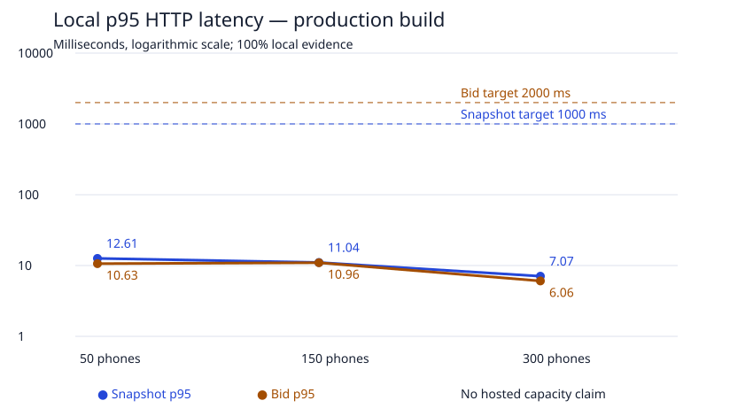

# Nov 19: stage 1 local evidence

**Historical local report and original staging proposal.** The subsequent approved as-is hosted rehearsal is complete; see [staging results](NOV19_STAGING_LOAD_RESULTS.md). Approval/pending statements below describe the local report's original boundary. Stage 1 now has separate local and hosted evidence; the measurements in this file remain local-only.

Source: `1ee003bc978692b3525ad47d0ab2b18646dea53d`. No application, schema, dependency, or UI changes were needed. This is a production Next.js build in local application mode against a fresh disposable database, not hosted capacity evidence. Stage 1 remains open pending approved staging results; stages 2–5 have not begun.

## Workload and machine

- Apple M4 Max; 16 logical CPUs; 48 GiB RAM; darwin 27.0.0, arm64.
- Node v24.4.1, pnpm 12.4.2; PostgreSQL 18.6 (Homebrew) on aarch64-apple-darwin27.0.0, compiled by Apple clang version 21.0.0 (clang-2100.3.34.2), 64-bit.
- Dedicated app port 3469 and Postgres port 55469. Local database cluster and app are stopped and removed by the runner's finally block. Existing servers and worktrees are untouched.
- Each run joins 50, 150 or 300 separate cookie sessions (20 concurrent joins), watches one item per phone and polls every four seconds. Sixty visible items, three hot items, 30 seconds of watching followed by a full 120-second closing burst, plus four seconds of polling through close. Respectively 9, 25 and 50 active bidders attempt a bid every two seconds, with evenly spaced starts.
- Every tenth bid is submitted concurrently twice with the same request ID; every seventh discards the application-visible result and recovers it from the receipt endpoint. The browser suite additionally aborts real committed responses. Expected competition and late-bid rejections are counted separately.
- A separate lock probe holds a standing lock until after an item's close, observes the bid waiting on that lock, releases it and asserts a CLOSED receipt whose database decision timestamp follows lock release. Its intentional two-second wait is reported separately and excluded from ordinary bid latency.

## Latency and throughput

Latency is milliseconds, p50 / p95 / p99, including reading and decoding the HTTP response body. Snapshots include the initial fetch per joined phone; snapshots/s excludes those initial fetches. Bids/s includes duplicate HTTP submissions and expected rejections, averaged over the whole window (including its 30 seconds without bidding). Runs share one warm app process in 50 → 150 → 300 order; JIT warmup and contention vary, so latency need not rise monotonically with phone count. Target: snapshot p95 <1,000 ms and bid p95 <2,000 ms at 300 phones.

| Phones | Snapshot p50 / p95 / p99 | Bid p50 / p95 / p99 | Poll snapshots/s | Bid HTTP/s |
| ---: | ---: | ---: | ---: | ---: |
| 50 | 6.42 / 12.61 / 22.6 | 5.85 / 10.63 / 16.73 | 12.45 | 3.90 |
| 150 | 5.97 / 11.04 / 17.16 | 5.74 / 10.96 / 17.08 | 37.39 | 10.84 |
| 300 | 3.91 / 7.07 / 14.16 | 3.76 / 6.06 / 8.75 | 74.60 | 21.64 |

## Resources and durable correctness

CPU is observed CPU time divided by workload elapsed time: 100% is one logical CPU. The app and owned Postgres process trees are sampled with ps, summing per-process positive deltas so backend turnover cannot subtract earlier work. One-second samples omit the final CPU tail of a backend that exits before the next sample, and connection/lock samples can miss shorter peaks. The load client shares the same machine. Connection counts include the single observer connection (the app pool remains capped at five).

| Phones | App CPU | Postgres CPU | Max DB connections | Sampled lock waiters | Accepted bids | Durable decisions | Max decoded snapshot KiB |
| ---: | ---: | ---: | ---: | ---: | ---: | ---: | ---: |
| 50 | 6.88% | 2.91% | 6 | 0 | 91 | 550 | 43.20 |
| 150 | 15.72% | 7.73% | 6 | 1 | 121 | 1526 | 47.13 |
| 300 | 18.75% | 10.87% | 6 | 0 | 151 | 3052 | 51.06 |

All three runs independently queried the database: zero duplicate bids, missing/wrong receipts, orphan accepted receipts, incorrect leaders/amounts/counts/next sequences, sequence/time/amount ordering violations, or bids outside the server-decided window. Both accepted and rejected decisions have durable receipts. All run fixtures were deleted and absence confirmed by SQL. Each raw result retains its observed-lock/release/decision timestamps.

| Phones | Unexpected failures | Expected HTTP rejections (includes replay) | Duplicate pairs | Receipt recoveries | Schedule lag p95 / p99 ms |
| ---: | ---: | --- | ---: | ---: | ---: |
| 50 | 0 | BELOW_MINIMUM: 456; ALREADY_LEADING: 35; CLOSED: 9 | 54 | 72 | 1.63 / 18.63 |
| 150 | 0 | BELOW_MINIMUM: 1476; ALREADY_LEADING: 35; CLOSED: 25 | 150 | 200 | 1.7 / 20.56 |
| 300 | 0 | BELOW_MINIMUM: 3090; ALREADY_LEADING: 35; CLOSED: 51 | 300 | 400 | 1.41 / 13.82 |

## Measurement-led decision

Retain the current engine, response shape and pool configuration. All local targets pass, with zero correctness failures or unexpected HTTP failures. No measurement justifies a cache, ETag, polling change or snapshot rewrite at this boundary.

pg_stat_statements captures top queries, calls, returned rows and execution time in each raw JSON file. A joined snapshot performs 11 reads plus BEGIN, SET LOCAL and COMMIT (14 SQL commands when donations are disabled). At 300 phones the polling schedule alone implies about 1,050 SQL commands/s. The full-event bid-history read remains proportional to accumulated history, and every snapshot sends all 60 items. Neither these local database round trips nor a single warm Node server establish Neon/Vercel performance. Hosted measurements must examine round-trip cost, payload growth, contention, cold starts and per-instance pool multiplication before choosing an optimization.

## Poor-network verification

Chromium and WebKit each passed: offline stale timestamp and disabled bid submission; API-only 3G approximation (400ms each way, 128kbit/s down, 64kbit/s up); Sending until the durable receipt; committed response loss; pending request persistence across reload with failed receipt access; three down/up cycles; original receipt recovery with exactly one bid. JavaScript-disabled simple mode recovers a committed lost form response and offers only the original request ID when a receipt is unknown.

This is browser-engine/API emulation, not real radio conditions, a physical iPhone, older iOS or venue wifi evidence. Screenshots are retained locally under `.shots/nov19/`; the machine-readable scenario receipt is [resilience.json](../evidence/nov19/resilience.json).

## Validation

The final checks-only run exited 0 against another fresh disposable cluster, with the same application source and production build. [Retained validation log](../evidence/nov19/validation.log):

- Node 24 and pnpm 12.4.2; local-target guards and backend-turnover CPU regression passed.
- `pnpm typecheck` and `pnpm build` passed.
- `pnpm compat`: 63 JS/TS modules, all CSS, zero blocking findings.
- `tests/v1/journey.mjs`: 55/55 passed.
- `tests/v1/bid-sheet.mjs` and `tests/v1/simple-ui.mjs`: Chromium and WebKit passed.
- `tests/v1/compat-api.mjs`: 8/8 telemetry checks passed.
- `tests/load/resilience.mjs`: four poor-network scenarios per engine, plus mismatched-database guard rejection and fixture cleanup, passed.
- The owned app and disposable Postgres were stopped and the temporary cluster removed after both load and final checks.

Remaining risks, in order: hosted capacity and database round trips are unmeasured; this fixture reaches only 91/121/151 accepted bids and does not establish performance with a full day's accumulated history or image delivery; engineer alerts and restore proof await stages 2–3; physical phones, venue wifi, named staff and two-metre QR rehearsals remain human evidence. The runbook and morning-of preflight await stages 4–5.

## Staging approval boundary

**Not run and not accessed.** Proposed target is only https://staging.bidzizi.com. Repository release notes identify Vercel project `bidzizi-real-v1-staging` (`prj_nQdWJzjZjFg0TY2MjlTf2hxWtBf9`) and Neon fork `staging-compat-20261013` (`br-crimson-mountain-arsolcfe`), project `delicate-math-48681189`. These identities are documentation-derived and must be read back before any run; the currently hosted revision has not been inspected in this task.

Requested follow-up scope: read-only provider/deployment/isolation verification, then the same 50 → 150 → 300 session workload in three uniquely named practice events under a staging-only test organization/account. Reuse an available isolated staging test account, or explicitly authorize provisioning one in that fork. No copied Saturn event, staff account, production endpoint or production data is a test fixture. A separate guarded hosted driver must be prepared after approval; the local driver deliberately rejects staging.

The three measured runs together made 19,751 snapshot requests, 5,629 ordinary bid requests, 672 receipt lookups, 500 joins and 500 watch writes, plus host setup/cleanup and three lock probes. Budget roughly 28,000 HTTP requests and 8–12 minutes including setup/cleanup, with about 7.7 minutes of scheduled workload. Bounding every snapshot by its run's observed maximum gives 0.92 GiB of decoded snapshot JSON; wire compression, hosted execution time, Neon compute/egress and billing depend on the actual provider plan and cannot be priced from local evidence. Do not create a paid plan or increase a provider limit as part of this approval.

Abort on unexpected errors, failed invariants, target identity drift or crossing the acceptance p95 thresholds (1s snapshots, 2s bids); stop new bids, let in-flight decisions settle, collect only the test fixtures' evidence and delete only those practice events. Confirm fixture absence and check the preserved copied records against a pre-run digest. Keep deletion scoped by event UUID and a unique run marker. If the hosted application source differs from the locally measured source, stop and present the exact staging deployment change for separate authorization; load approval does not authorize deploying. No staging load, provisioning, deployment or provider access is authorized yet. After hosted evidence is recorded in a follow-up stage 1 commit, proceed to stage 2's separate alert selection/resource approval.

## Reproduction and evidence

See [tests/load/README.md](../../tests/load/README.md). Raw measurements: [50 phones](../evidence/nov19/baseline-50.json), [150 phones](../evidence/nov19/baseline-150.json), [300 phones](../evidence/nov19/baseline-300.json). Workload settings and machine details are embedded in every result.

Harness bring-up caught and fixed an expected CLOSED-probe classification error and a CPU accounting error when idle Postgres backends exited. The full series was repeated with a regression-tested per-process CPU sampler. Browser-harness bring-up also corrected an ambiguous action-bar selector and waited for outstanding throttled route handlers before navigating. These were measurement/test errors, not application request failures. Load and final-check development logs are local at `/tmp/nov19-readiness-local.log` and `/tmp/nov19-readiness-checks.log`; the committed validation log records the final passing checks.
