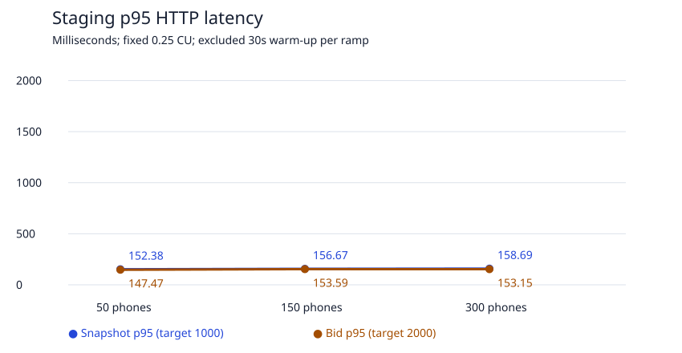
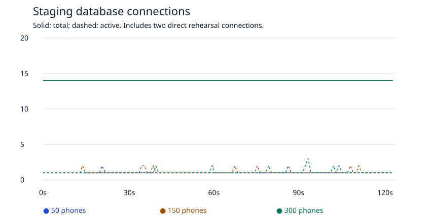

# Nov 19: approved staging rehearsal

**PASS** — as-is staging rehearsal completed 2026-10-14T23:22:27.410Z. 27246 application API requests, in 50 → 150 → 300 order. Stop condition: none; no challenge, block, 429 or unexpected request failure. Provider configuration and domain deployments unchanged: true. Independent cleanup confirmed: true.

## Scope and binding

Only https://staging.bidzizi.com received rehearsal traffic. Pinned Vercel project `prj_nQdWJzjZjFg0TY2MjlTf2hxWtBf9`, deployment `dpl_84j5YvYHCn18XZxycpMckLTf5ftf`, source `088e3b0316cc42914a17d80ca4ef04cf3f3d3761`. Direct verified-TLS staging connections used Neon project `delicate-math-48681189`, branch `br-crimson-mountain-arsolcfe`, endpoint `ep-orange-cake-aryndhab`. Production sessions on `br-cold-glitter-arx1msrh` defaulted to read-only and only inspected limits and the absence of random fixture IDs. No production application request was made by this rehearsal.

The user explicitly accepted fixed 0.25 CU staging as a conservative test of production's 0.25 CU autoscaling floor. Staging autosuspends after 300s; production scales to 8 CU and does not autosuspend. Both domains served the same source, Node 24, pdx1, Fluid/standard memory functions and 300s timeout. Live max_connections remained 112 staging / 901 production; documented 90% pool allocation implies approximately 101 / 811 backend slots per user/database, rather than a live PgBouncer configuration read. No provider alignment, scaling, firewall, deployment, schema, dependency or application change was made. Before/after provider GETs found no active custom firewall rules, attack-challenge mode or active anomaly.

The isolated test account was provisioned only in staging with an in-memory random password. Each practice event was created through the staging API, directly read from the pinned staging database and independently checked absent from production before joining:

| Phones | API-created event UUID | Direct staging proof | Production read-only proof |
| ---: | --- | --- | --- |
| 50 | `854423db-3825-4822-8474-63bc0b8bfa95` | confirmed | absent |
| 150 | `4cf680fa-473b-487a-8c96-45d329ef6983` | confirmed | absent |
| 300 | `6c95adaa-62e6-4024-b092-bdd30520cd40` | confirmed | absent |

## Workload and timing

Sixty visible image-free items; three hot items; 9 / 25 / 50 active bidders for 50 / 150 / 300 separate cookie sessions. Up to 20 simultaneous joins, a watch per phone, four-second polling, one bid attempt per active bidder every two seconds, deterministic staggering and at most one outstanding request per action except deliberate duplicate submissions. Every tenth attempt is sent twice concurrently with the original request ID. Every seventh placement is discarded as an application-visible outcome and recovered through the receipt endpoint. Local Chromium/WebKit tests separately cover actual committed response loss, offline/throttled/flapping connections and simple mode.

Account/event/item creation, joins, initial snapshots, watches and the 30s warm-up are excluded from measured latency. The two-minute measured bid burst schedules bids through 122s and polls through 124s to cross close. Closing time is set from the staging database clock, scoped only to the practice fixture. A deliberate standing-lock close probe is separate and excluded from ordinary bid latency.

| Phones | Excluded warm-up began UTC | Measurement began UTC | Measurement ended UTC | Observed seconds |
| ---: | --- | --- | --- | ---: |
| 50 | 2026-10-14T23:14:10.979Z | 2026-10-14T23:14:41.075Z | 2026-10-14T23:16:45.075Z | 124.00 |
| 150 | 2026-10-14T23:16:56.873Z | 2026-10-14T23:17:26.948Z | 2026-10-14T23:19:31.948Z | 125.00 |
| 300 | 2026-10-14T23:19:45.387Z | 2026-10-14T23:20:15.472Z | 2026-10-14T23:22:20.472Z | 125.00 |

Load generator: Apple M4 Max, 16 logical CPUs, darwin 27.0.0 arm64, Node v24.4.1. Generator checkout base `795287fe12352fabbc4624f29690aea9421704e1`; final committed harness accompanies these results. Executed staging.mjs SHA-256: `05dd06590baed3fffacaf52282209aa530217e8699194911f278021752aad937`. The actual served application source is the deployment source above.

## Latency and throughput

Milliseconds, including HTTP response decoding. Targets: snapshot p95 <1,000ms and bid p95 <2,000ms. Setup and excluded warm-up are not included. Expected competition/closed decisions and deliberate duplicate HTTP requests remain in ordinary bid latency.

| Phones | Snapshot p50 / p95 / p99 ms |
| ---: | ---: |
| 50 | 76.33 / 152.38 / 175.4 |
| 150 | 77.57 / 156.67 / 187.73 |
| 300 | 80.19 / 158.69 / 188.95 |

| Phones | Bid p50 / p95 / p99 ms |
| ---: | ---: |
| 50 | 73.3 / 147.47 / 177.26 |
| 150 | 73.57 / 153.59 / 176.42 |
| 300 | 75.09 / 153.15 / 185.03 |

| Phones | Snapshots/s | Bid HTTP/s | Measured snapshots | Measured bid HTTP | Schedule lag p95 / p99 ms |
| ---: | ---: | ---: | ---: | ---: | ---: |
| 50 | 12.50 | 4.86 | 1550 | 603 | 1.25 / 2.59 |
| 150 | 37.20 | 13.40 | 4650 | 1675 | 1.51 / 3.2 |
| 300 | 74.40 | 26.80 | 9300 | 3350 | 1.31 / 2.9 |

## Capacity and cold starts

Direct pg_stat_activity samples were scheduled every second, grouped by state for this database's client backends. Counts include the control and read-only observer connections and any other existing connections to that staging database. State peaks occur at different instants and must not be summed. One-second observations can miss subsecond peaks; sampled lock waiters do not exclude transient lock contention. The close probe runs after this sampling window. No instance-count inference is made from database connections.

| Phones | Samples | Peak total connections | Peak active | Peak idle | Peak idle in transaction | Peak lock waiters |
| ---: | ---: | ---: | ---: | ---: | ---: | ---: |
| 50 | 124 | 14 | 2 | 13 | 2 | 0 |
| 150 | 125 | 14 | 2 | 13 | 4 | 0 |
| 300 | 125 | 14 | 3 | 13 | 6 | 1 |

Vercel function invocation counts below are filtered by each unique event's guest API prefix and pinned deployment. They cover guest join/watch, warm-up, measured requests, receipt recovery and close probe; host provisioning/deletion is excluded. Provider time windows are rounded to minutes. Counts therefore cannot precisely attribute cold starts to the excluded warm-up versus measurement within boundary minutes. Totals are checked against the driver's known guest request schedule to detect incomplete ingestion. Metric collection: 2026-10-14T23:26:02.811Z.

| Phones | Cold starts | Hot starts | Prewarmed starts | Provider total / expected guest HTTP | Totals match |
| ---: | ---: | ---: | ---: | ---: | --- |
| 50 | 20 | 2731 | 0 | 2751 / 2751 | yes |
| 150 | 0 | 8101 | 0 | 8101 / 8101 | yes |
| 300 | 0 reported; incomplete | 16183 | 0 | 16183 / 16201 | no |

**Open observability limitation:** at 300 phones the provider reports 18 fewer invocations than observed guest HTTP requests. Repeated reads plateaued at this total; a separate exact-path breakdown localizes the gap to 11 snapshots and 7 bids, with joins, watches and receipt lookups reconciled. Zero reported cold starts at 300 does not prove that all 16,201 guest requests were hot. The workload/SQL acceptance pass is separate from this incomplete metric reconciliation. The evidence checker deliberately exits nonzero for this gap; it is not relabeled as a complete observability pass. See [metric reconciliation receipt](../evidence/nov19/staging-metric-reconciliation.json). No provider configuration change or additional application load was made to investigate it.

Trustworthy function-instance counts were unavailable and are omitted as authorized. Invocation IDs and cold-start counts do not establish simultaneous VM counts. Hosted app/Postgres CPU was also unavailable; it is not inferred from latency. One-second connection states are the approved capacity signal.

## Durable correctness, rejection and cleanup

Every run independently checked: duplicate participant/request bids; missing or wrong accepted-bid receipts; orphan accepted receipts; leader/current amount/bid count/next sequence against raw bids; contiguous item sequences with strictly increasing accepted amounts and nondecreasing decision times; accepted bids within effective server-time windows; and every HTTP-observed receipt against durable JSON. All checks operate only on the practice event. The close probe observes the specific request waiting while open on the controlled standing lock, releases after close and requires a CLOSED receipt decided after release. Exact timestamps remain in the raw JSON.

| Phones | Accepted bids | Durable decisions | HTTP receipts compared | Duplicate pairs | Receipt recoveries | SQL checks | Lock/close proof | Event cleanup |
| ---: | ---: | ---: | ---: | ---: | ---: | --- | --- | --- |
| 50 | 92 | 550 | 550 | 54 | 72 | PASS | PASS | confirmed |
| 150 | 123 | 1526 | 1526 | 150 | 200 | PASS | PASS | confirmed |
| 300 | 135 | 3051 | 3051 | 300 | 400 | PASS | PASS | confirmed |

Expected HTTP rejections include duplicate replays and do not represent platform errors:

| Phones | Expected rejection counts |
| ---: | --- |
| 50 | BELOW_MINIMUM: 468; ALREADY_LEADING: 28; CLOSED: 9 |
| 150 | BELOW_MINIMUM: 1494; ALREADY_LEADING: 27; CLOSED: 25 |
| 300 | BELOW_MINIMUM: 3132; ALREADY_LEADING: 25; CLOSED: 52 |

All practice events were deleted after their audits. Final cleanup removed the owned account, org, staff sessions, staff request records and hashed login attempt. Fresh read-only connections independently confirmed zero matching orgs, staff, events, items, participants, bids, standings, staff requests, sessions, password tokens, client reports and login attempts in both staging and production at 2026-10-14T23:22:39.345Z. Foreign keys prevent retained bids/receipts/watches with deleted parents. No copied event, real account, production row or provider resource was deleted. See [independent cleanup receipt](../evidence/nov19/staging-cleanup-proof.json).

## Decision and limits

All three ramps passed; no measurement justifies an application or provider change. Retain the current application and configuration.

This is evidence for the **warmed, image-free, short-duration workload at 0.25 CU**. It conservatively exercises production's compute floor but is not a full production-capacity guarantee. Only 50 of 300 phones actively bid in the highest ramp; the fixture accumulates 135 accepted bids, so full-day bid history, simultaneous joining, all-phone bidding, image delivery, venue wifi and long-running load remain unproven. Local browser/network evidence remains distinct from a physical phone or venue rehearsal. Alerts, restore drill, day-of runbook and preflight are subsequent stages with their existing approval boundaries.

Raw evidence: [rehearsal and one-second samples](../evidence/nov19/staging-rehearsal.json), [cold-start metric receipt](../evidence/nov19/staging-cold-starts.json), [cleanup proof](../evidence/nov19/staging-cleanup-proof.json). Reproduction and safety boundaries: [load README](../../tests/load/README.md). Separate authorized production bypass removal: [security receipt](NOV19_BYPASS_REMOVAL.md).
