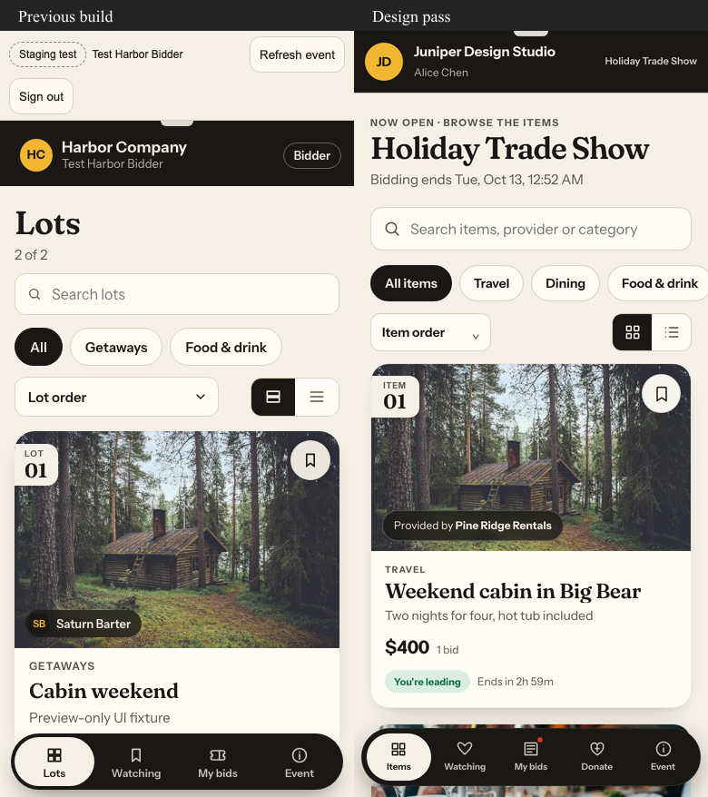
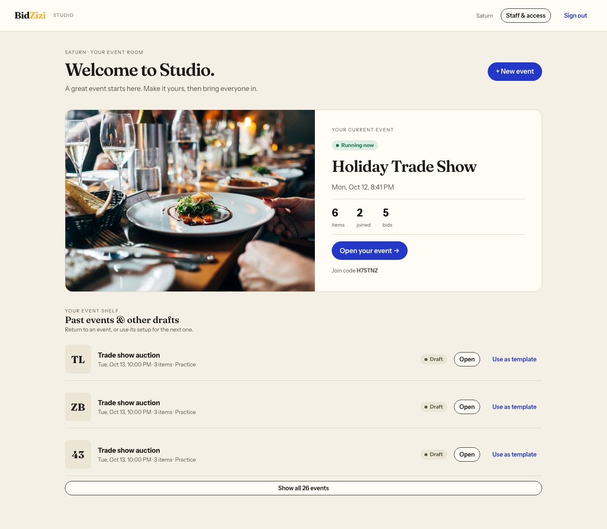

# Real V1 — Oct 19 review checkpoint

Prepared for Zack’s Oct 19 review. This is the locally implemented Oct 13–19 tranche, built from `015e27e868935d2a1fcc670913e0a620bac992e3` (`real-v1/t1-foundation`) on `jryear/real-v1-design-pass`. The tranche is delivered as three local commits: backend operations (`a36f883`), connected design and browser checks (`d81cdb0`), and this checkpoint with its captures. Use `git log -3` for the complete delivered commit list. The tested application source is `d81cdb0`; the final checkpoint commit adds evidence only. Visual acceptance remains Zack’s decision.

## Decisions preserved

- Saturn’s first user is a Saturn staff member, not Zack. They will author the real Nov 19 trade-show event themselves. No real staff account or real event has been created.
- Planned production origin: `https://app.bidzizi.com`. No domain, provider or deployment configuration was changed.
- Staff host; participants join an event with a name and a business label. No verification, membership or admission workflow was added.
- The selected Design A pass header, Fraunces/Instrument typography, cobalt actions, marigold identity, photo cards and ticket anatomy remain the visual foundation. Previous markup and CSS at `staging-demo-final` informed the adaptation; the staging application and migrations 001–019 remain history.

## What is ready locally

The participant app has photo-led cards with item numbers, provider chips and watch controls; search, categories, sort and large/compact views; icon navigation; ticket-style My bids grouped by standing, expandable bid history and Bid again; a photo-led event page with welcome, schedule, venue, sponsors, donation information and winning guidance; and a richer item page with time left, watch, current standing and bid history. Other bidders’ names are not exposed in the history list. An uncertain bid remains explicitly unconfirmed until its original server receipt is recovered.

Studio home centres the running or next real event, ahead of practice rooms. Templates appear inside New event. Other drafts and past events form a compact shelf with a show-all control and Use as template. The Set up / Live / Results workflow, themes, editable canvas and autosave remain. The phone top bar is simpler, copying has moved under Make a copy, no-photo items have deliberate number artwork, and the setup schedule starts unchecked. Selecting canvas content on a phone scrolls to its editor. Live includes item search and selecting an item scrolls to its operations on a phone. Draft preview explicitly requires staff sign-in on that device.

No-developer operations are in the connected UI:

| Operation | Where | Behaviour |
|---|---|---|
| Void bid | Live → select item → Void bid | Reason required. Records remain; standing is recomputed from active bids under the item/standing locks. Re-void is safe. Sequence numbers remain monotonic. Original receipts remain historical decisions. Voiding an awarded bid invalidates its award; staff choose a replacement in Results. |
| Withdraw item | Live → select item → Withdraw item | Stops new bids and awards, retains history and shows the staff message to participants. Withdrawn standing is excluded from Raised so far. |
| Change close | Live → select item → Item closes, or Set up | Server enforces timing. Closing with bids can be shortened only to at least five minutes from now. |
| Edit participant | Live → participant options → Edit participant | Name/business change on the remembered participant identity; bids stay attached. |
| Invite / password reset | Studio home → Staff & access | Staff create a private one-time link and share it themselves. Link expires in 24 hours; redemption revokes old sessions. Pending invitations can be reissued. Refresh staff updates acceptance from another device. |
| Practice | New event → Practice event | Clearly labelled. Reset removes rehearsal activity, keeps setup, rotates join code and returns to draft. Reset retries use the same request ID and cannot erase a later rehearsal. |
| Delete / archive | Set up → Event → Event housekeeping | Practice events may be deleted with activity. Unjoined real drafts may be deleted. Draft/practice events may be archived with records retained, then restored from housekeeping. Destructive reset/delete require typing the event name. Joined real events cannot be reset/deleted or relabelled as practice. |

Staff password recovery needs another signed-in colleague. There is no email delivery or unauthenticated email recovery service. Invite the second staff member and verify both accounts before rehearsal. If the sole staff member loses every session and their password, administrator recovery is still needed. Sign-in copy makes this limitation explicit.

## Verification

Run with Node 24 and pnpm 12.4.2. The actual Node 24 executable used for the final checks was `/Users/jryear/.nvm/versions/node/v24.4.1/bin/node` (the Homebrew `node@24` path on this machine currently reports Node 26).

- `tests/v1/journey.mjs`: **40/40 passed** against disposable `bz_test_design` on Postgres 18, `127.0.0.1:55433`, application port 3412. Includes duplicate/retried and concurrent bidding, close, winners, pledges, rejoin, exports, void/re-void/current leader/nonleader/all bids, concurrent bid/void, immutable item restrictions after void, award invalidation, withdrawal, participant edits, closing changes, practice reset replay after a new join, deletion safeguards, cross-organization denial, expired/reused password tokens and session revocation.
- `tests/v1/operations-ui.mjs`: **passed** through the rendered Studio: void, withdrawal, edit, reset, delete, invite, password setup, reset and old-session revocation. No page errors.
- `tests/v1/bid-keyboard.mjs`: **passed**; bid-sheet initial focus, forward/backward focus containment, Escape and focus restoration, with no bid sent.
- `pnpm typecheck`: **passed**.
- `pnpm build`: **passed**, including the password setup routes and the connected participant/Studio routes.
- `tests/v1/studio-shots.mjs`: **passed**; no page errors and no horizontal overflow at 390px or 1440px.
- `tests/v1/shots.mjs`: connected synthetic event with uploaded local reference photos, two participant identities, leading/outbid states, item/detail/history/event views, compact browsing, watch/search and recovery captures. See the evidence boundary below for response fixtures.

Plain-text receipts are retained in [design-pass-oct19](design-pass-oct19/). The final local checks bind this worktree, not hosted release acceptance. No shared staging data was used. All migration/provision/test writes were confined to separate `bz_test_*` databases.

## Visual review — matching widths, side by side

The manager inspected the previous and candidate captures side by side before this checkpoint, including the catalog and My bids at both widths and Studio setup/live. The review caught and corrected native button styling, advancing offline timestamps, Studio phone overflow and home event prioritisation. Different synthetic content and differing product workflows are visible in the comparisons; they are not pixel-diff claims.

| Screen | 390px | 1440px |
|---|---|---|
| Participant catalog | [Before / after](design-pass-oct19/screenshots/participant/comparison-390-catalog.png) | [Before / after](design-pass-oct19/screenshots/participant/comparison-1440-catalog.png) |
| My bids | [Before / after](design-pass-oct19/screenshots/participant/comparison-390-my-bids.png) | [Before / after](design-pass-oct19/screenshots/participant/comparison-1440-my-bids.png) |
| Item detail | [Before / after](design-pass-oct19/screenshots/participant/comparison-390-item-detail.png) | [Before / after](design-pass-oct19/screenshots/participant/comparison-1440-item-detail.png) |
| Studio setup | [Before / after](design-pass-oct19/screenshots/comparisons/studio-390-setup.png) | [Before / after](design-pass-oct19/screenshots/comparisons/studio-1440-setup.png) |
| Studio live | [Before / after](design-pass-oct19/screenshots/comparisons/studio-390-live.png) | [Before / after](design-pass-oct19/screenshots/comparisons/studio-1440-live.png) |
| Studio home | [Candidate](design-pass-oct19/screenshots/studio/studio-390-home.png) | [Candidate](design-pass-oct19/screenshots/studio/studio-1440-home.png) |
| Event page | [Before / after](design-pass-oct19/screenshots/participant/comparison-390-event.png) | [Before / after](design-pass-oct19/screenshots/participant/comparison-1440-event.png) |





Hard-state captures include [offline](design-pass-oct19/screenshots/participant/participant-390-offline.png), [unconfirmed bid](design-pass-oct19/screenshots/participant/participant-390-unconfirmed.png), [long title / no photo](design-pass-oct19/screenshots/participant/participant-390-no-photo-long-title-detail.png), [closed](design-pass-oct19/screenshots/participant/participant-1440-closed-fixture.png), [won](design-pass-oct19/screenshots/participant/participant-1440-won-fixture.png) and [empty](design-pass-oct19/screenshots/participant/participant-390-empty-fixture.png).

Offline is exercised by browser network loss; unconfirmed bidding by aborting the response/request in the screenshot harness. Files ending `-fixture` render deliberately intercepted API responses for visual coverage of terminal/empty states; they do not prove durable winners or empty-event correctness. Real closed/winner transitions are separately tested by the HTTP journey. All screenshot events and people are synthetic. The Event comparison uses the previous participant welcome/event view from the candidate refinement reference set; content and the host/join model differ.

## Review and next executable action

On Oct 19, review the participant catalog/detail/My bids/Event and Studio home/setup/live at both widths, then use the local connected build for a short staff rehearsal: create a practice event, invite a colleague, join on two devices, bid, void the leader, withdraw an item, edit a participant, adjust closing, reset practice and inspect Results. Visual acceptance is pending Zack; tests do not grant it.

Retained local preview: `http://127.0.0.1:3412/studio` and `/join`. This loopback address is accessible on this Mac, not a phone elsewhere. The local `host@example.com` account is synthetic; use the local test credentials supplied for this task. No credentials or setup links are included in the captures/checkpoint.

To restart from this worktree:

```sh
export PATH=/Users/jryear/.nvm/versions/node/v24.4.1/bin:$PATH
export BIDZIZI_APP_MODE=local
export BIDZIZI_DATABASE_URL=postgres://bz@127.0.0.1:55433/bz_test_design
pnpm db:migrate
pnpm dev --port 3412 --hostname 127.0.0.1
```

To reproduce the full journey, set `BASE=http://127.0.0.1:3412`, `HOST_EMAIL`, `HOST_PASSWORD` and the local test database URL, then run `node tests/v1/journey.mjs` and `node tests/v1/operations-ui.mjs`. With a photo event seeded, `node tests/v1/bid-keyboard.mjs` verifies the bid-sheet keyboard interaction. Capture with `node tests/v1/shots.mjs <output>` followed by `node tests/v1/studio-shots.mjs <output>`. Comparison helpers use the on-disk previous screenshot folder and are local tooling, not runtime dependencies.

Oct 20 deployment and Saturn account creation still require Zack’s go. Later production/rehearsal work remains: a real phone/desktop deployment check, Saturn independently authoring the Nov 19 event, two real-phone rehearsals, 300-phone load evidence and polling/backoff tuning, engineer alerts, backups, day-of runbook and printable QR/table cards. None of these later milestones is claimed by this local design/operations checkpoint.
